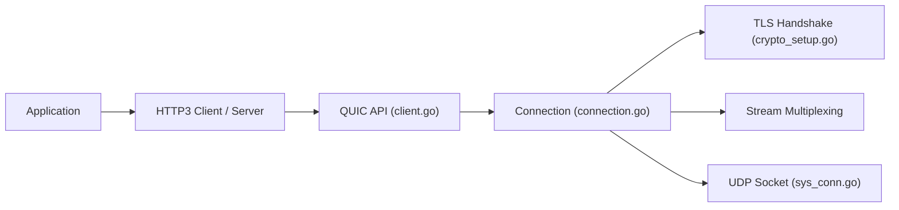

# quic-go/quic-go

> Implementation of the QUIC protocol and HTTP/3 in pure Go, for network developers.

## The problem
Using QUIC and HTTP/3 in Go without depending on C libraries.

## What it actually does
Implements QUIC (RFC 9000, 9001, 9002), datagrams, version 2, qlog, and HTTP/3 with QPACK. Since v0.60, it can be used in a FIPS 140-3 environment with Go 1.26 or later. The README lists projects that use it (Caddy, traefik, syncthing, cloudflared…).

## How it is wired

## Trying it
No command in the README; documentation at quic-go.net.

## Cost and gotchas
Free. Follows the last two Go versions. 218 open issues.

## What it is not
Not a ready-to-use web server: WebTransport, MASQUE and CONNECT-IP are separate related projects.

## Alternatives
webtransport-go, masque-go and connect-ip-go, for the related protocols.

## For you
Keep an eye on it: an infrastructure building block in Go, useful only if you build network services; unrelated to data/AI.
