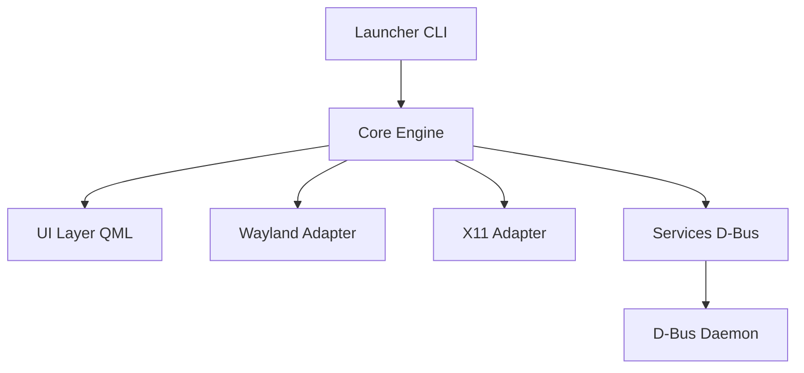

# quickshell-mirror/quickshell

> QML framework for building desktop bars and interfaces on Wayland and X11.

## The problem
Composing your own bar, widgets and notifications under a Wayland compositor means assembling them from disparate tools.

## What it actually does
The README describes almost nothing. From the code: a C++ engine with Qt and QML, Wayland and X11 adapters, a D-Bus module and services (greetd, mpris, notifications, pam, pipewire, status_notifier, upower), plus IPC through Unix sockets and window management.

## How it is wired


## Trying it
```bash
# Le README ne donne aucune commande : installation et usage sont sur le site du projet.
```

## Cost and gotchas
Free, LGPL-3.0. Mirror repo: the main repo is on git.outfoxxed.me. It needs a compatible Linux desktop environment.

## What it is not
Not a window manager nor a compositor: it hooks onto what exists. Not documented in this README: everything is referred to the website.

## Alternatives
No alternative named in the README.

## For you
To ignore: a Linux desktop customization tool, unrelated to a data / AI / MLOps profile, and a README too thin to judge.
