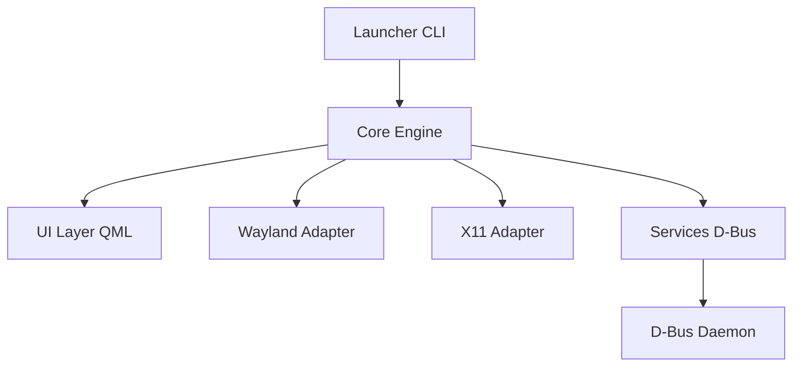

# quickshell-mirror/quickshell

> Cadre QML pour construire des barres et interfaces de bureau sous Wayland et X11.

## Le problème
Composer sa barre, ses widgets et ses notifications sous un compositeur Wayland demande de l'assembler à partir d'outils disparates.

## Ce que ça fait vraiment
Le README ne décrit presque rien. D'après le code : un moteur C++ avec Qt et QML, des adaptateurs Wayland et X11, un module D-Bus et des services (greetd, mpris, notifications, pam, pipewire, status_notifier, upower), plus IPC par sockets Unix et gestion de fenêtres.

## Comment c'est branché


## Essayer
```bash
# Le README ne donne aucune commande : installation et usage sont sur le site du projet.
```

## Coût et pièges
Gratuit, LGPL-3.0. Dépôt miroir : le dépôt principal est sur git.outfoxxed.me. Il faut un environnement de bureau Linux compatible.

## Ce que ce n'est pas
Pas un gestionnaire de fenêtres ni un compositeur : il se greffe sur l'existant. Pas documenté dans ce README : tout est renvoyé au site.

## Alternatives
Aucune alternative nommée dans le README.

## Pour toi
À ignorer : outil de personnalisation de bureau Linux, sans rapport avec un profil data / IA / MLOps, et README trop mince pour juger.

