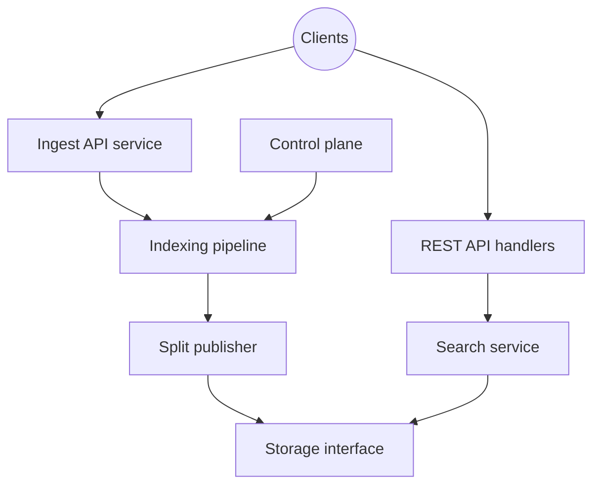

# quickwit-oss/quickwit

> Search engine for logs and traces, stored on S3, designed for observability teams.

## The problem
Indexing and querying large volumes of logs is expensive with Elasticsearch, whose storage is coupled to compute.

## What it actually does
Receives documents through an API (Elasticsearch-compatible, OTEL, Jaeger) or from Kafka, Kinesis, Pulsar. Turns them into "splits" written to object storage. Searches are stateless and read those splits. A control plane distributes indexing. Metrics are only on the roadmap.

## How it is wired


## Trying it
No command is given in the README provided (only links to "Installation" and the quickstarts: Stack Overflow, Grafana, Jaeger).
```bash
# non documenté dans le README fourni
```

## Cost and gotchas
Object storage (S3, Azure, GCS) is at your expense. Indexing high availability only exists with a Kafka source.

## What it is not
Not a full Elasticsearch replacement: only a large subset of the API is supported. No metrics for now.

## Alternatives
- Elasticsearch / OpenSearch: full API, but more expensive according to the README.
- Solr: cited as a traditional engine.

## For you
Watch: useful if you must index logs or traces cheaply on S3, useless for a pure data/ML need without observability.
