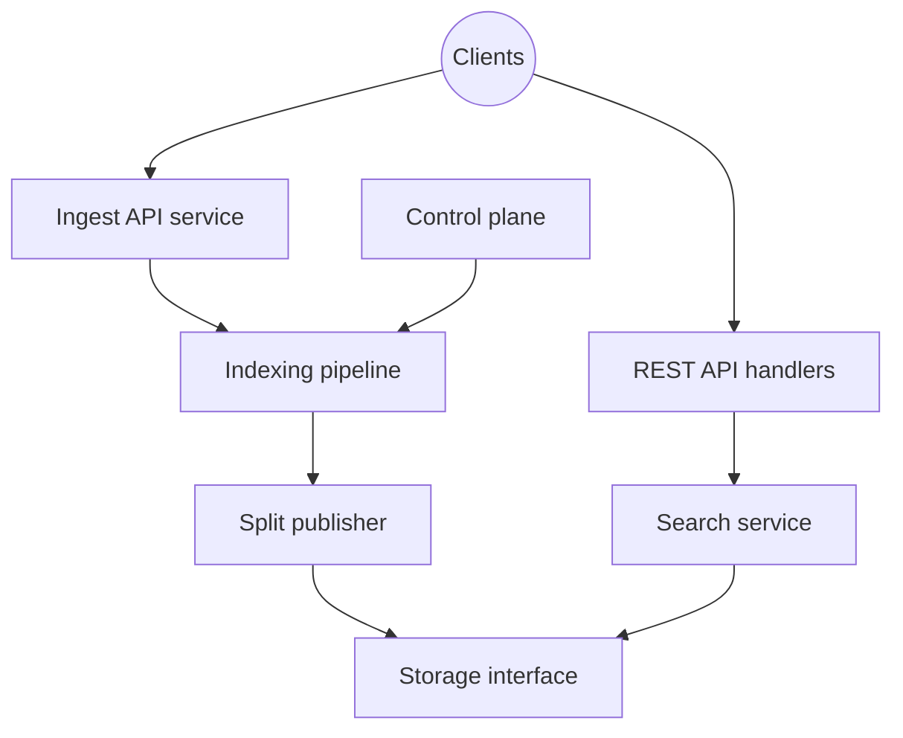

# quickwit-oss/quickwit

> Moteur de recherche pour logs et traces, stocké sur S3, pensé pour les équipes d'observabilité.

## Le problème
Indexer et interroger de gros volumes de logs coûte cher avec Elasticsearch, dont le stockage est couplé au calcul.

## Ce que ça fait vraiment
Reçoit des documents par API (compatible Elasticsearch, OTEL, Jaeger) ou depuis Kafka, Kinesis, Pulsar. Les transforme en « splits » écrits sur un stockage objet. Les recherches sont sans état et lisent ces splits. Un plan de contrôle répartit l'indexation. Les métriques sont seulement sur la feuille de route.

## Comment c'est branché


## Essayer
Aucune commande n'est donnée dans le README fourni (seulement des liens vers « Installation » et les quickstarts : Stack Overflow, Grafana, Jaeger).
```bash
# non documenté dans le README fourni
```

## Coût et pièges
Un stockage objet (S3, Azure, GCS) à votre charge. La haute disponibilité de l'indexation n'existe qu'avec une source Kafka.

## Ce que ce n'est pas
Pas un remplaçant complet d'Elasticsearch : seul un large sous-ensemble de l'API est géré. Pas de métriques pour l'instant.

## Alternatives
- Elasticsearch / OpenSearch : API complète, mais plus coûteux selon le README.
- Solr : cité comme moteur traditionnel.

## Pour toi
Surveiller : utile si tu dois indexer des logs ou traces à bas coût sur S3, inutile pour un pur besoin data/ML sans observabilité.

