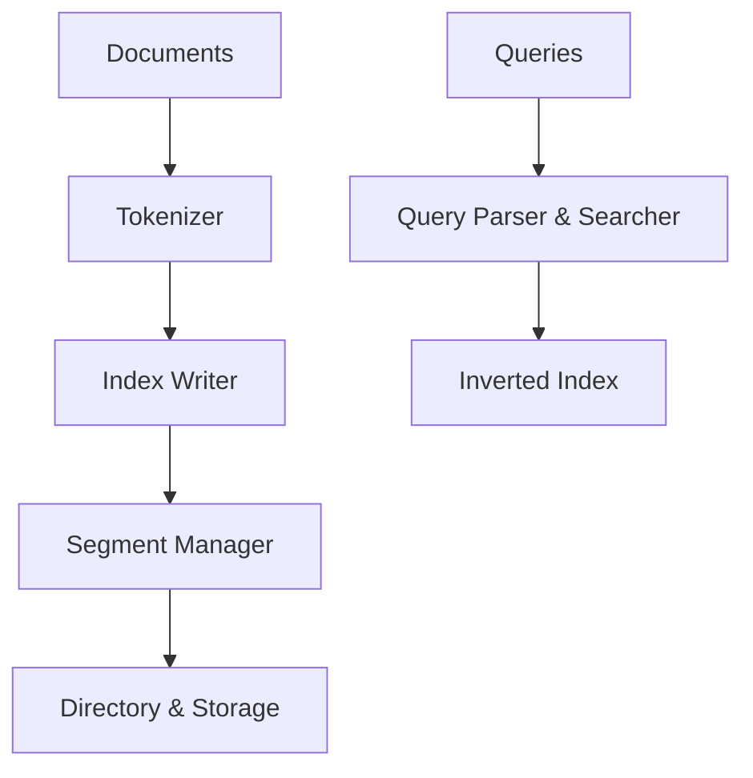

# quickwit-oss/tantivy

> Rust full-text search library close to Lucene, for building your own search engine.

## The problem
Having full-text search built into your application without an Elasticsearch or Solr server.

## What it actually does
Indexes and queries text with BM25, a query language, phrase and range queries, faceted search, JSON fields, aggregations and fast fields. Incremental, multi-threaded indexing, startup under 10 ms, mmap-based storage. Documents are immutable: modifying one means deleting then reindexing.

## How it is wired
Diagram based on the code's diagram, simplified.



## Trying it
```bash
git clone https://github.com/quickwit-oss/tantivy.git
cd tantivy
cargo test
```

## Cost and gotchas
Free (MIT). Stable Rust required, missing from the prerequisites. Distributed search is out of scope (see Quickwit). A `commit` is needed to make documents visible.

## What it is not
Not a ready-to-use search server: a library. Not distributed. Benchmark figures vary with the workload, says the README.

## Alternatives
- Quickwit: distributed engine built on Tantivy.
- tantivy-py: Python binding.
- lnx: search engine with a REST API, cited in the README.

## For you
Keep an eye on it: through tantivy-py, useful for local full-text search over RAG corpora, with no server to operate.
