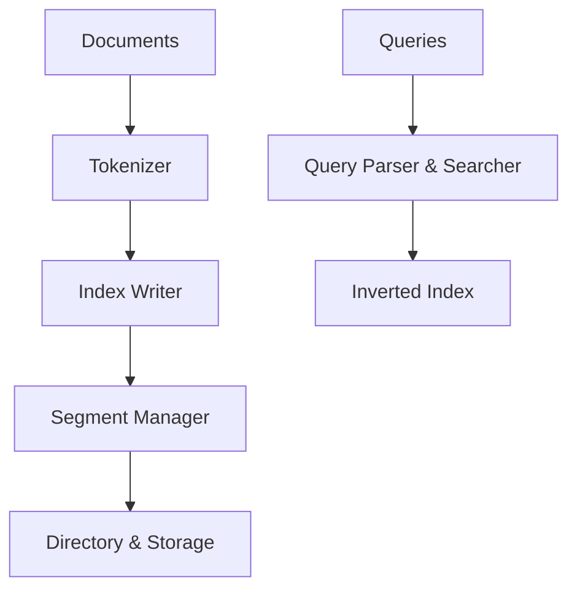

# quickwit-oss/tantivy

> Bibliothèque Rust de recherche plein texte proche de Lucene, pour construire son propre moteur de recherche.

## Le problème
Avoir une recherche plein texte intégrée à son application sans serveur Elasticsearch ou Solr.

## Ce que ça fait vraiment
Indexe et interroge du texte avec BM25, langage de requête, requêtes de phrase et de plage, recherche à facettes, champs JSON, agrégations et champs rapides. Indexation incrémentale et multi-thread, démarrage sous 10 ms, stockage par mmap. Les documents sont immuables : modifier revient à supprimer puis réindexer.

## Comment c'est branché
Schéma d'après le diagramme du code, simplifié.



## Essayer
```bash
git clone https://github.com/quickwit-oss/tantivy.git
cd tantivy
cargo test
```

## Coût et pièges
Gratuit (MIT). Rust stable requis, absent des prérequis. La recherche distribuée est hors périmètre (voir Quickwit). Un `commit` est nécessaire pour rendre les documents visibles.

## Ce que ce n'est pas
Pas un serveur de recherche prêt à l'emploi : une bibliothèque. Pas distribué. Les chiffres de benchmark varient selon la charge, dit le README.

## Alternatives
- Quickwit : moteur distribué construit sur Tantivy.
- tantivy-py : liaison Python.
- lnx : moteur de recherche avec API REST, cité dans le README.

## Pour toi
À surveiller : via tantivy-py, utile pour une recherche plein texte locale sur des corpus de RAG, sans serveur à exploiter.

