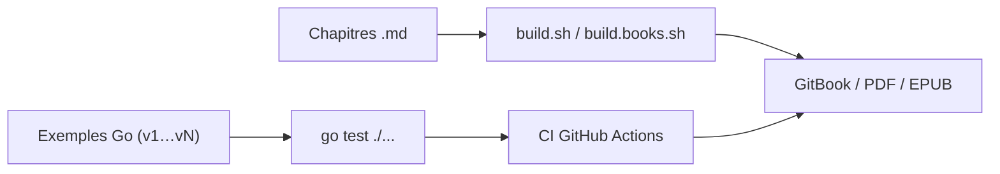

# quii/learn-go-with-tests

> Free course to learn Go and TDD by writing tests, for Go beginners.

## The problem
Learning a language by reading alone stays abstract and poorly structured.

## What it actually does
A book in chapters: Go basics (21 chapters), building an application (HTTP server, JSON, WebSockets, time), testing fundamentals (acceptance tests, fakes without mocks, refactoring) and questions and answers. Each chapter has versioned code (v1, v2…). Available as GitBook, EPUB or PDF, with many translations.

## How it is wired

## Trying it
No command documented in the provided README; it points to installing Go and to the online chapters.

## Cost and gotchas
Free. You need Go, an editor and a bit of programming experience. The content evolves with Go versions (for example `testing/synctest`, Go 1.25).

## What it is not
It is not a language reference: it teaches by example and by testing, without being exhaustive.

## Alternatives
- Go by example: cited as a learning base that worked for the author.
- The Go blue book: cited as too demanding in commitment.

## For you
Watch: useful if you have to write tools or services in Go; of no interest if you stay on Python.
