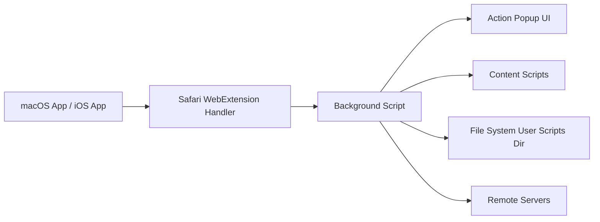

# quoid/userscripts

> Userscript editor and manager for Safari, on macOS and iOS.

## The problem
Safari does not offer a userscript manager equivalent to Tampermonkey.

## What it actually does
A WebExtension (Svelte/Vite: popup, page, background script, content scripts) reads and writes `.user.js` and `.css` files in a chosen folder, through a native Swift app. It handles `@match`, `@run-at`, `@require`, a `GM.*` API and updates via `@updateURL`.

## How it is wired

## Trying it
Install via Apple's App Store (link in the README). No command documented.

## Cost and gotchas
Free, but distributed only through the App Store. `@require` downloads remote resources without validation. The README admits that the update process is not fully implemented.

## What it is not
It is not a scraping or AI tool. It works only on Safari, and only on http/https.

## Alternatives
No alternative named in the README (Violentmonkey is cited as a behavior reference).

## For you
Ignore: a Safari utility unrelated to data/AI work.
