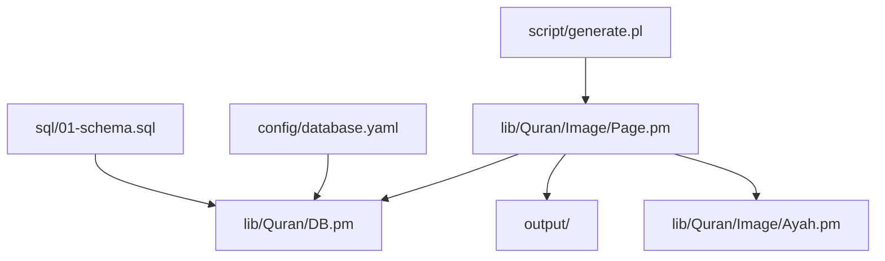

# quran/quran.com-images

> Perl scripts that generate the quran.com Quran page images from the Madani fonts.

## The problem
Displaying faithful Quran pages and highlighting each word or verse requires images and the bounds of each glyph.

## What it actually does
`script/generate.pl` drives the Page and Ayah modules, reads a MySQL database (`sql/`) and writes the images to `output/`. It also records the bounds of each glyph in the database. A compression step with zopflipng is recommended.

## How it is wired


## Trying it
```bash
docker-compose up -d
docker-compose run gen /app/script/generate.pl --output ./output/ --width 1300 --pages 1..3
docker-compose down
```

## Cost and gotchas
Requires Perl, a MySQL server and ideally Docker Compose. The catalogue declares no license; the README mentions GPL for the code, but the fonts belong to the King Fahd Complex.

## What it is not
Not a Quran reader nor a reusable library: an image generator tied to the original Madani fonts.

## Alternatives
No alternative named in the README.

## For you
Ignore: very specific Perl tooling, ambiguous license, unrelated to data/AI/MLOps.
