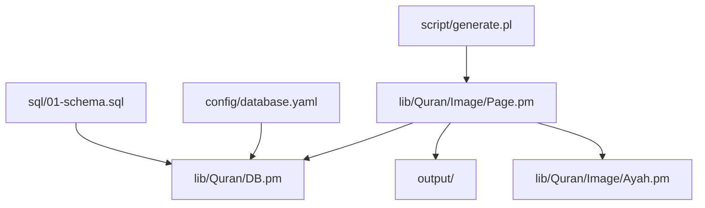

# quran/quran.com-images

> Scripts Perl qui génèrent les images des pages du Coran de quran.com à partir des polices Madani.

## Le problème
Afficher des pages de Coran fidèles et surligner chaque mot ou verset demande des images et les limites de chaque glyphe.

## Ce que ça fait vraiment
`script/generate.pl` pilote les modules Page et Ayah, lit une base MySQL (`sql/`) et écrit les images dans `output/`. Il enregistre aussi en base les limites de chaque glyphe. Une étape de compression par zopflipng est conseillée.

## Comment c'est branché


## Essayer
```bash
docker-compose up -d
docker-compose run gen /app/script/generate.pl --output ./output/ --width 1300 --pages 1..3
docker-compose down
```

## Coût et pièges
Demande Perl, un serveur MySQL et idéalement Docker Compose. Le catalogue ne déclare aucune licence ; le README parle de GPL pour le code, mais les polices appartiennent au Complexe du Roi Fahd.

## Ce que ce n'est pas
Pas un lecteur de Coran ni une bibliothèque réutilisable : un générateur d'images lié aux polices Madani d'origine.

## Alternatives
Aucune alternative nommée dans le README.

## Pour toi
À ignorer : outillage Perl très spécifique, licence ambiguë, sans lien avec data/IA/MLOps.

