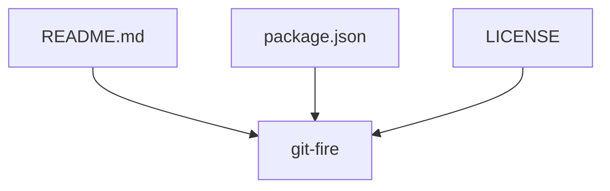

# qw3rtman/git-fire

> Git plugin that commits everything and pushes commits and stashes to a new branch in an emergency.

## The problem
Sometimes you have to leave the machine quickly while leaving unpushed work behind.

## What it actually does
The script sits at the repository root, creates a `fire-<branch>-<date>` branch, adds all files, commits (customizable message), then pushes the commits and all stashes to the remote. The repository is just a shell script declared as a binary in `package.json`.

## How it is wired
Diagram based on the one provided.



## Trying it
```bash
npm install -g git-fire
git config --global alias.out fire
git-fire
```

## Cost and gotchas
Free. Last push in 2022. It commits everything, including sensitive files that are not ignored, to the remote.

## What it is not
Not a backup nor a good practice: the README presents it as a joke. The alias names `git out` and `git going` are humorous.

## Alternatives
No alternative named in the README.

## For you
Ignore: a `git add -A && git commit && git push` alias does the same thing, and pushing everything without sorting risks publishing data or keys.
