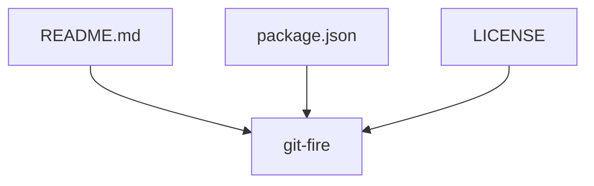

# qw3rtman/git-fire

> Plugin Git qui valide tout et pousse commits et stashes vers une nouvelle branche en urgence.

## Le problème
Il faut parfois quitter la machine vite en laissant du travail non poussé.

## Ce que ça fait vraiment
Le script se place à la racine du dépôt, crée une branche `fire-<branche>-<date>`, ajoute tous les fichiers, commite (message personnalisable) puis pousse les commits et tous les stashes vers le distant. Le dépôt n'est qu'un script shell déclaré comme binaire dans `package.json`.

## Comment c'est branché
Schéma d'après le diagramme fourni.



## Essayer
```bash
npm install -g git-fire
git config --global alias.out fire
git-fire
```

## Coût et pièges
Gratuit. Dernier push en 2022. Il commite tout, y compris des fichiers sensibles non ignorés, vers le distant.

## Ce que ce n'est pas
Pas une sauvegarde ni une bonne pratique : le README le présente comme un clin d'œil. Les noms d'alias `git out` et `git going` sont humoristiques.

## Alternatives
Aucune alternative nommée dans le README.

## Pour toi
À ignorer : un `git add -A && git commit && git push` en alias fait la même chose, et pousser tout sans tri risque de publier des données ou des clés.

