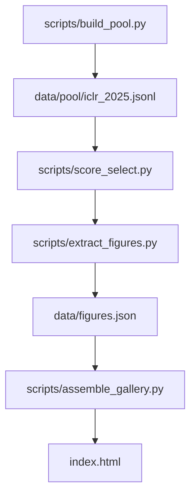

# qwdwqfwq/topconf-paper-figure-gallery

> A searchable gallery of the Figure 1s from 3,452 papers at major AI conferences, for layout inspiration.

## The problem
Drawing a paper's main figure calls for layout references, scattered across thousands of PDFs.

## What it actually does
A static site indexes the Figure 1s of ICLR, ICML, NeurIPS, CVPR, ACL and AAAI (2023 to 2026) with filters by conference, year, award and visual type, plus full-text search. A Python pipeline builds the data (pool, extraction, scoring, dHash deduplication, review). The FigureForge tool, in the browser, generates a draft figure from references.

## How it is wired


## Trying it
```bash
git clone https://github.com/qwdwqfwq/topconf-paper-figure-gallery.git
cd topconf-paper-figure-gallery
python -m http.server 8000
```

## Cost and gotchas
Free for the gallery. FigureForge needs your own model API key, kept in the browser. The images belong to the authors and publishers; the author promises removal within 72 hours. License not identified by GitHub; README loaded with API sponsors.

## What it is not
It is not a ranking of papers: only a layout reference. It is not a royalty-free dataset for training.

## Alternatives
No alternative named in the README.

## For you
Worth watching: handy for illustrating your own papers or presentations, but check image rights and the license before any reuse.
