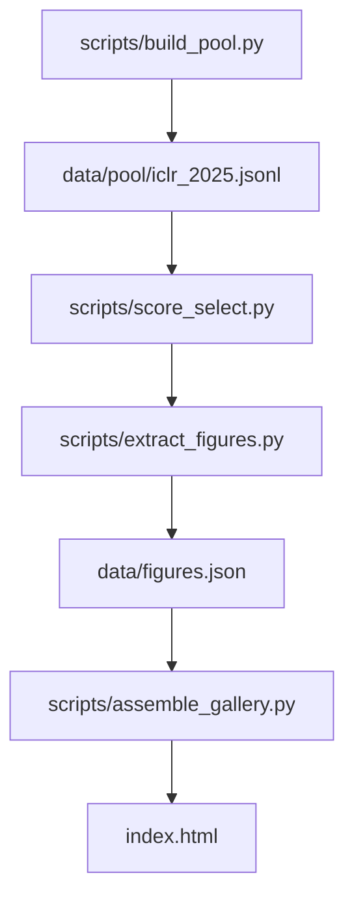

# qwdwqfwq/topconf-paper-figure-gallery

> Galerie cherchable des Figure 1 de 3 452 articles de grandes conférences d'IA, pour s'inspirer de leur mise en page.

## Le problème
Dessiner la figure principale d'un article demande des références de mise en page, dispersées dans des milliers de PDF.

## Ce que ça fait vraiment
Un site statique indexe les Figure 1 d'ICLR, ICML, NeurIPS, CVPR, ACL et AAAI (2023 à 2026) avec filtres par conférence, année, distinction et type visuel, et recherche plein texte. Un pipeline Python assemble les données (pool, extraction, score, dédoublonnage dHash, relecture). L'outil FigureForge, dans le navigateur, génère un brouillon de figure à partir de références.

## Comment c'est branché


## Essayer
```bash
git clone https://github.com/qwdwqfwq/topconf-paper-figure-gallery.git
cd topconf-paper-figure-gallery
python -m http.server 8000
```

## Coût et pièges
Gratuit pour la galerie. FigureForge demande ta clé d'API de modèle, conservée dans le navigateur. Les images appartiennent aux auteurs et éditeurs ; l'auteur promet un retrait sous 72 heures. Licence non identifiée par GitHub ; README chargé de sponsors d'API.

## Ce que ce n'est pas
Ce n'est pas un classement d'articles : seulement une référence de mise en page. Ce n'est pas un jeu de données libre de droits pour l'entraînement.

## Alternatives
Aucune alternative nommée dans le README.

## Pour toi
À surveiller : pratique pour illustrer ses propres articles ou présentations, mais droits d'image et licence à vérifier avant tout réemploi.

