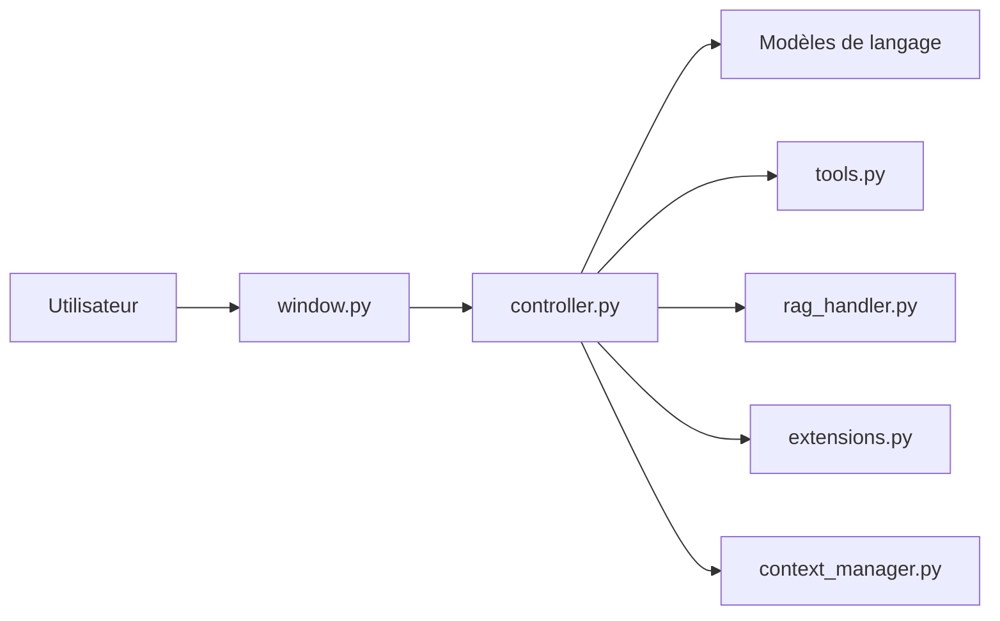

# qwersyk/Newelle

> GNOME desktop AI assistant: chat with models, MCP tools, voice, documents and extensions.

## The problem
AI assistants are closed web services; on a Linux desktop, there is no local client that plugs in models, tools and files.

## What it actually does
Desktop application (GNOME/Flatpak) for chatting with several model providers or local models (Llama.cpp, Ollama). It adds tools and MCP, skills, web search, RAG over documents, voice, image generation, long-term memory and execution of commands proposed by the AI. A central controller orchestrates the handler families; extensions extend it all.

## How it is wired


## Trying it
```bash
flatpak install flathub io.github.qwersyk.Newelle
flatpak run io.github.qwersyk.Newelle --mini
nix-shell -p newelle
```

## Cost and gotchas
API key at your own expense for remote models. The Flathub version is sandboxed; giving it access to the terminal and files reduces security, as the README says.

## What it is not
Not a hosted service nor a cross-platform app: it is a GNOME client. Builds outside Flathub lack the translations. No privacy guarantee with proprietary models.

## Alternatives
No alternative cited in the README (only a fork, Nyarch Assistant, is mentioned).

## For you
Worth watching: useful if you work under GNOME with Ollama and MCP, but it is a desktop client, not a reusable building block in an MLOps pipeline.
