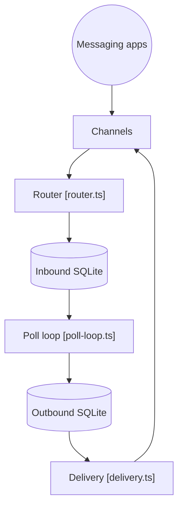

# qwibitai/nanoclaw

> Personal AI assistant that runs Claude agents in isolated Docker containers, with a small, forkable codebase.

## The problem
Giving an agent broad access to your digital life without understanding a huge codebase, nor real system isolation.

## What it actually does
A Node host routes messages (Slack, Telegram, WhatsApp, etc.) to one Bun container per agent group. Two SQLite files per session (inbound, outbound), each with a single writer. Credentials go through a OneCLI gateway, never inside the container. Alternative channels and providers are added through skills.

## How it is wired


## Trying it
```bash
git clone https://github.com/nanocoai/nanoclaw.git nanoclaw-v2
cd nanoclaw-v2
bash nanoclaw.sh
```

## Cost and gotchas
Anthropic credential required by default; Docker, Node 22+ and pnpm 10+. Anonymous setup diagnostics, which can be turned off with `NANOCLAW_NO_DIAGNOSTICS=1`. The prebuilt image requires a free account. Claude Code is used for `/customize` and error recovery.

## What it is not
Not configurable through files: you modify the code. The README contrasts the project with OpenClaw without a quantified comparison. This repository has an exact duplicate (nanocoai/nanoclaw).

## Alternatives
- OpenClaw: richer but much bigger, according to the README.

## For you
Worth watching: good container isolation model for agents, but tied to Claude Code and Docker; test it on a dedicated machine.
