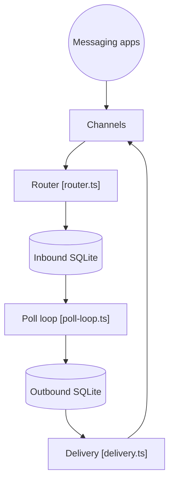

# qwibitai/nanoclaw

> Assistant IA personnel qui exécute des agents Claude dans des conteneurs Docker isolés, code réduit et à forker.

## Le problème
Donner à un agent un accès large à sa vie numérique sans comprendre un énorme code, ni vraie isolation système.

## Ce que ça fait vraiment
Un hôte Node route les messages (Slack, Telegram, WhatsApp, etc.) vers un conteneur Bun par groupe d'agents. Deux fichiers SQLite par session (entrée, sortie), chacun avec un seul écrivain. Les identifiants passent par une passerelle OneCLI, jamais dans le conteneur. Canaux et fournisseurs alternatifs s'ajoutent par skills.

## Comment c'est branché


## Essayer
```bash
git clone https://github.com/nanocoai/nanoclaw.git nanoclaw-v2
cd nanoclaw-v2
bash nanoclaw.sh
```

## Coût et pièges
Crédential Anthropic requis par défaut ; Docker, Node 22+ et pnpm 10+. Diagnostics anonymes de setup, coupables par `NANOCLAW_NO_DIAGNOSTICS=1`. L'image préfabriquée demande un compte gratuit. Claude Code sert à `/customize` et à la reprise d'erreurs.

## Ce que ce n'est pas
Pas configurable par fichiers : on modifie le code. Le README oppose le projet à OpenClaw sans le comparer chiffré. Ce dépôt a un doublon exact (nanocoai/nanoclaw).

## Alternatives
- OpenClaw : plus riche mais bien plus gros, selon le README.

## Pour toi
À surveiller : bon modèle d'isolation par conteneur pour agents, mais lié à Claude Code et à Docker ; à tester sur une machine dédiée.

