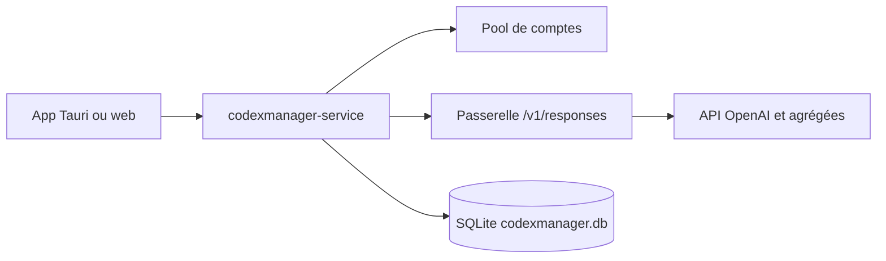

# qxcnm/Codex-Manager

> Codex account pool manager with an OpenAI-compatible local gateway, as a desktop or web application.

## The problem
Anyone who owns several ChatGPT/Codex accounts has to switch accounts by hand when a 5-hour or 7-day quota runs out.

## What it actually does
Imports and manages accounts (groups, labels, banned filters, remaining usage), authorizes them via OAuth or Device Code, issues platform keys and routes requests through a single endpoint (Codex CLI, Gemini CLI, Claude Code). Model catalog with pricing, third-party aggregated APIs, image generation, plugin center, skill installation, SQLite database.

## How it is wired


## Trying it
```bash
# Aucune commande documentée dans le README : télécharger un paquet depuis GitHub Releases,
# lancer l'application, cliquer « Start Service », puis ajouter un compte.
```

## Cost and gotchas
Free, but relies on existing ChatGPT accounts. The author says they only guarantee the Windows build and that 98% of the code was written with Codex.

## What it is not
The README itself forbids bypassing rate limits, which account rotation encourages: compliance with OpenAI's terms to be checked. Not an enterprise proxy.

## Alternatives
No alternative named in the README.

## For you
Ignore: the value lies in pooling personal accounts, with a compliance and reliability risk that no serious data/AI need justifies.
