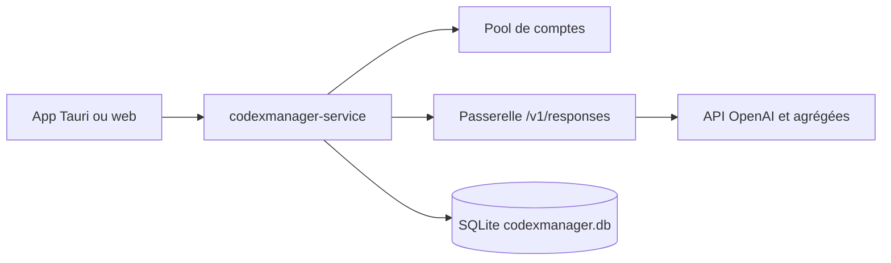

# qxcnm/Codex-Manager

> Gestionnaire de pool de comptes Codex avec passerelle locale compatible OpenAI, en application de bureau ou web.

## Le problème
Qui possède plusieurs comptes ChatGPT/Codex doit changer à la main de compte quand un quota de 5 heures ou de 7 jours est épuisé.

## Ce que ça fait vraiment
Importe et gère des comptes (groupes, étiquettes, filtres de bannis, usage restant), les autorise par OAuth ou Device Code, émet des clés de plateforme et route les requêtes via un endpoint unique (Codex CLI, Gemini CLI, Claude Code). Catalogue de modèles avec tarifs, API agrégées tierces, génération d'images, centre de plugins, installation de skills, base SQLite.

## Comment c'est branché


## Essayer
```bash
# Aucune commande documentée dans le README : télécharger un paquet depuis GitHub Releases,
# lancer l'application, cliquer « Start Service », puis ajouter un compte.
```

## Coût et pièges
Gratuit, mais repose sur des comptes ChatGPT existants. L'auteur dit ne garantir que la build Windows et avoir écrit le code à 98 % avec Codex.

## Ce que ce n'est pas
Le README interdit lui-même de contourner les limites de débit, ce que la rotation de comptes encourage : conformité aux conditions d'OpenAI à vérifier. Pas un proxy d'entreprise.

## Alternatives
Aucune alternative nommée dans le README.

## Pour toi
À ignorer : la valeur tient à mutualiser des comptes personnels, avec un risque de conformité et de fiabilité que ne justifie aucun besoin data/IA sérieux.

