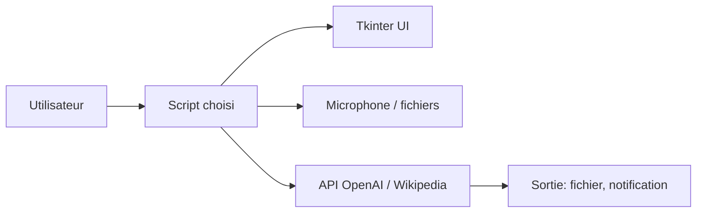

# qxresearch/qxresearch-event-1

> Collection of small Python scripts of about ten lines each: utilities, tkinter, ChatGPT applications.

## The problem
Python beginners looking for short projects to read and modify, backed by YouTube videos.

## What it actually does
Independent scripts: voice recorder, PDF protection and merging, link shortener, alarm, tkinter calendar, Wikipedia, plus ChatGPT applications (chatbot, Whisper, vector database, web summary). The architecture confirms these are separate applications, with no integrated product.

## How it is wired


## Trying it
```bash
pip install -r requirements.txt
```
API keys are replaced in the `yml` files of each project.

## Cost and gotchas
The ChatGPT applications require an OpenAI key. Configuration differs per project. The README contains a personal address for private lessons and a request to subscribe on YouTube.

## What it is not
Not a library nor a reference for good practices: teaching material, whose quality is not guaranteed.

## Alternatives
Not documented in the README.

## For you
Ignore: beginner level and demos; your data/MLOps needs are covered by more serious tools.
