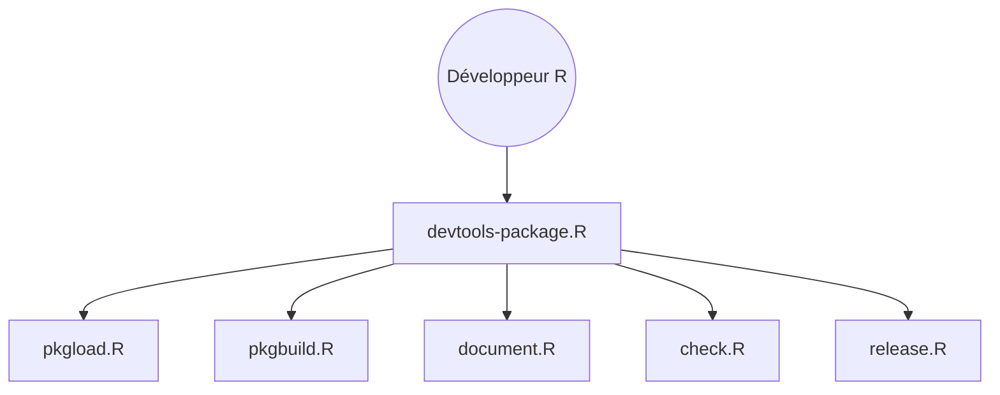

# r-lib/devtools

> Facade of R functions that speeds up common R package development tasks.

## The problem
Developing an R package means chaining loading, documentation, tests, build and CRAN publication through scattered tools.

## What it actually does
load_all simulates installation, document generates the documentation, test runs testthat, check builds and verifies the package, release prepares the CRAN submission. The install_* functions install from GitHub, GitLab or a URL. Most of the work is delegated to pkgload, pkgbuild, roxygen2, rcmdcheck, revdepcheck and usethis, installed automatically.

## How it is wired


## Trying it
```r
install.packages("devtools")
pak::pak("r-lib/devtools")
```

## Cost and gotchas
Free. Requires R. The license is present but not identified by GitHub. For a deployed package, the README advises depending directly on the split-out packages, not on devtools.

## What it is not
Not a data analysis tool: it is used to write R packages.

## Alternatives
pak to install packages; usethis to automate package setup; testthat for tests.

## For you
Ignore unless you publish R packages: most current data/AI work is in Python.
