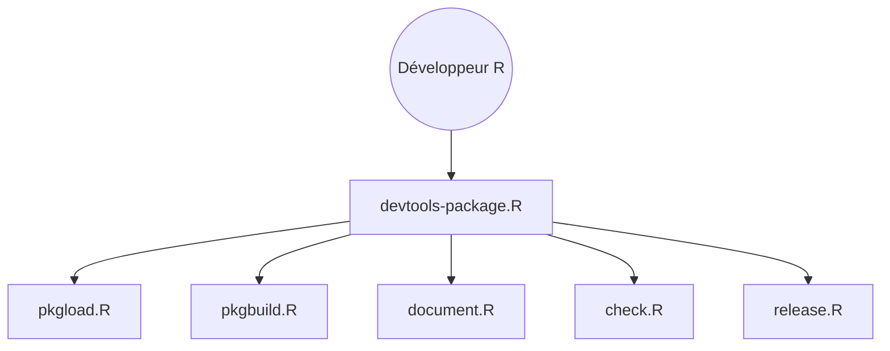

# r-lib/devtools

> Façade de fonctions R qui accélère les tâches courantes de développement de paquets R.

## Le problème
Développer un paquet R oblige à enchaîner chargement, documentation, tests, build et publication CRAN par des outils épars.

## Ce que ça fait vraiment
load_all simule l'installation, document génère la documentation, test lance testthat, check construit et vérifie le paquet, release prépare la soumission CRAN. Les install_* installent depuis GitHub, GitLab ou une URL. L'essentiel est délégué à pkgload, pkgbuild, roxygen2, rcmdcheck, revdepcheck et usethis, installés automatiquement.

## Comment c'est branché


## Essayer
```r
install.packages("devtools")
pak::pak("r-lib/devtools")
```

## Coût et pièges
Gratuit. Il faut R. La licence est présente mais non identifiée par GitHub. Pour un paquet déployé, le README conseille de dépendre directement des paquets découpés, pas de devtools.

## Ce que ce n'est pas
Pas un outil d'analyse de données : il sert à écrire des paquets R.

## Alternatives
pak pour installer des paquets ; usethis pour automatiser la configuration d'un paquet ; testthat pour les tests.

## Pour toi
À ignorer sauf si tu publies des paquets R : la plupart des travaux data/IA actuels sont en Python.

