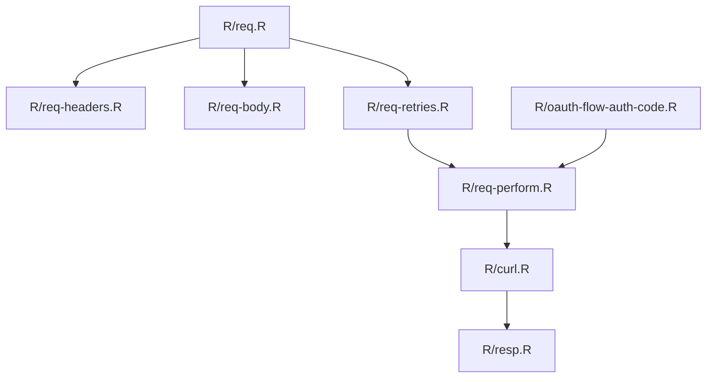

# r-lib/httr2

> HTTP client for R with explicit requests, retries, OAuth and secret handling, for anyone calling APIs.

## The problem
Calling a web API from R requires handling headers, retries on 429 errors, OAuth authentication and caching.

## What it actually does
You build a request object, modify it with the req_ functions, then req_perform sends it. HTTP errors become R errors, req_retry handles retries, req_cache caches, and secret_encrypt protects credentials. req_dry_run shows what will be sent.

## How it is wired


## Trying it
```r
install.packages("httr2")
library(httr2)
req <- request("https://r-project.org")
req |> req_dry_run()
resp <- req_perform(req)
```

## Cost and gotchas
Free, built on curl. The license is present but not identified by GitHub.

## What it is not
Not the httr package: the API is different and req_perform replaces GET, POST and DELETE.

## Alternatives
httr: the older version, of which httr2 is the successor.

## For you
Worth watching: adopt it if you call APIs in R, of no interest if you work in Python.
