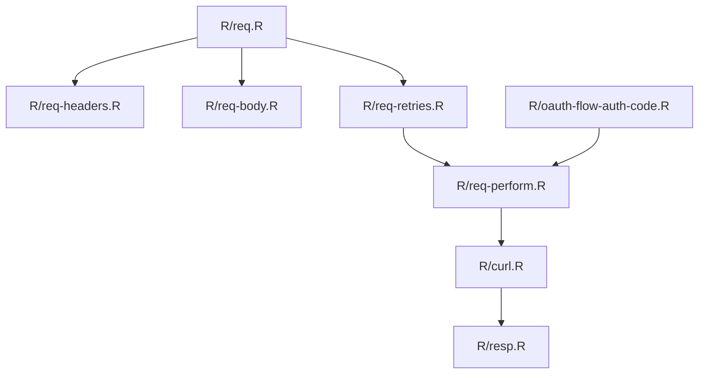

# r-lib/httr2

> Client HTTP pour R avec requêtes explicites, reprises, OAuth et gestion des secrets, pour qui appelle des API.

## Le problème
Appeler une API web depuis R demande de gérer en-têtes, reprises sur erreurs 429, authentification OAuth et mise en cache.

## Ce que ça fait vraiment
On construit un objet requête, on le modifie par les fonctions req_, puis req_perform l'envoie. Les erreurs HTTP deviennent des erreurs R, req_retry gère les reprises, req_cache met en cache, et secret_encrypt protège les identifiants. req_dry_run montre ce qui sera envoyé.

## Comment c'est branché


## Essayer
```r
install.packages("httr2")
library(httr2)
req <- request("https://r-project.org")
req |> req_dry_run()
resp <- req_perform(req)
```

## Coût et pièges
Gratuit, appuyé sur curl. La licence est présente mais non identifiée par GitHub.

## Ce que ce n'est pas
Pas le paquet httr : l'API est différente et req_perform remplace GET, POST et DELETE.

## Alternatives
httr : l'ancienne version, dont httr2 est le successeur.

## Pour toi
À surveiller : à adopter si tu appelles des API en R, sans intérêt si tu travailles en Python.

