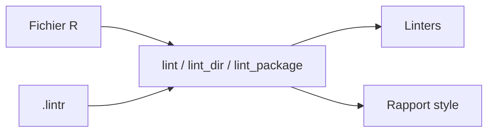

# r-lib/lintr

> Static analysis of R code: style, syntax errors and possible semantic problems.

## The problem
R code accumulates style deviations and pitfalls (`T` for `TRUE`, superfluous `return()`) that nobody reviews.

## What it actually does
`lintr::lint()` applies linters (assignment, braces, indentation, returns, etc.) and prints file:line:column with the linter name. Configuration via `use_lintr()`, project or package analysis, GitHub Actions integration via usethis. Complements `{styler}`, which restyles automatically.

## How it is wired


## Trying it
```bash
install.packages("lintr")
lintr::use_lintr(type = "tidyverse")
lintr::lint_dir()
lintr::lint_package()
```
(R commands)

## Cost and gotchas
Free. A license is present but not identified by GitHub.

## What it is not
Fixes nothing: it reports; `{styler}` is what reformats.

## Alternatives
`{styler}`, cited as an automatic complement.

## For you
Keep an eye on it: hook it into CI if you ship R code, useless in Python.
