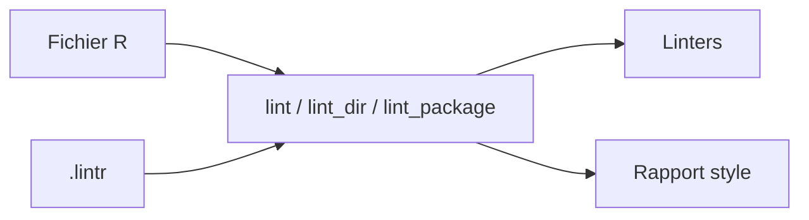

# r-lib/lintr

> Analyse statique de code R : style, erreurs de syntaxe et problèmes sémantiques possibles.

## Le problème
Le code R accumule des écarts de style et des pièges (`T` pour `TRUE`, `return()` superflu) que personne ne relit.

## Ce que ça fait vraiment
`lintr::lint()` applique des linters (assignation, accolades, indentation, retours, etc.) et affiche fichier:ligne:colonne avec le nom du linter. Configuration via `use_lintr()`, analyse de projet ou de paquet, intégration GitHub Actions via usethis. Complète `{styler}`, qui restyle automatiquement.

## Comment c'est branché


## Essayer
```bash
install.packages("lintr")
lintr::use_lintr(type = "tidyverse")
lintr::lint_dir()
lintr::lint_package()
```
(commandes R)

## Coût et pièges
Gratuit. Licence présente mais non identifiée par GitHub.

## Ce que ce n'est pas
Ne corrige rien : il signale ; c'est `{styler}` qui reformate.

## Alternatives
`{styler}`, cité comme complément automatique.

## Pour toi
À surveiller : à brancher en CI si tu livres du code R, inutile en Python.

