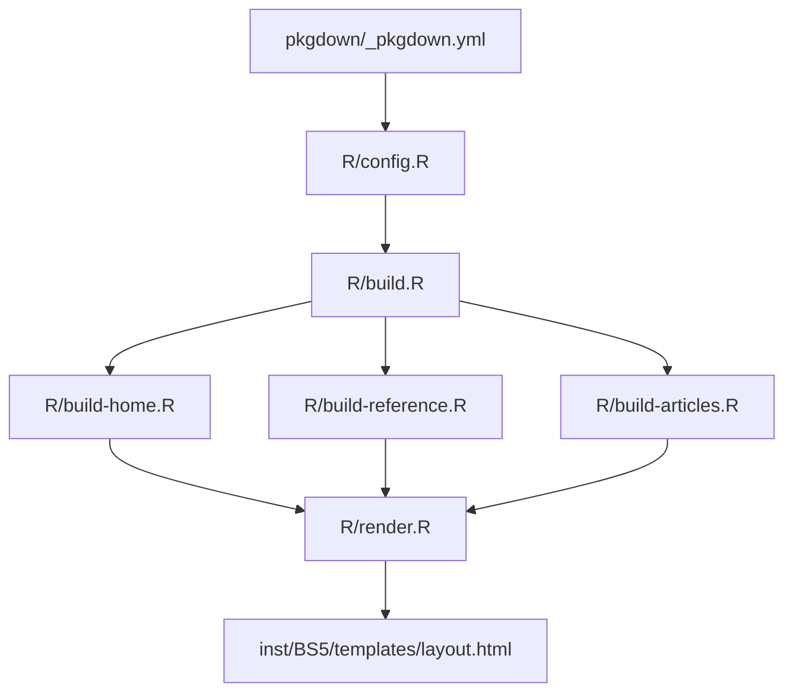

# r-lib/pkgdown

> Documentation website generator for an R package, from its README and vignettes.

## The problem
Documenting an R package on the web means assembling the home page, function reference, articles and release notes by hand.

## What it actually does
Reads `_pkgdown.yml`, turns the README into a home page, the `man/` documentation into a function reference and the vignettes into articles. HTML pages are output through Bootstrap 5 templates. Used by more than 12,000 packages according to the README.

## How it is wired


## Trying it
```bash
# Installer la version CRAN
install.packages("pkgdown")
# Configurer une fois le déploiement GitHub Pages
usethis::use_pkgdown_github_pages()
# Prévisualiser le site en local
pkgdown::build_site()
```

## Cost and gotchas
Free, but you need R. Moving to Bootstrap 5 requires an explicit option in `_pkgdown.yml` and may break a heavily customized site.

## What it is not
Not a general-purpose documentation generator: it only serves R packages. It does not write the documentation for you.

## Alternatives
No alternative named in the README.

## For you
Useful only if you publish an R package; in Python / MLOps it is of no use, so ignore.
