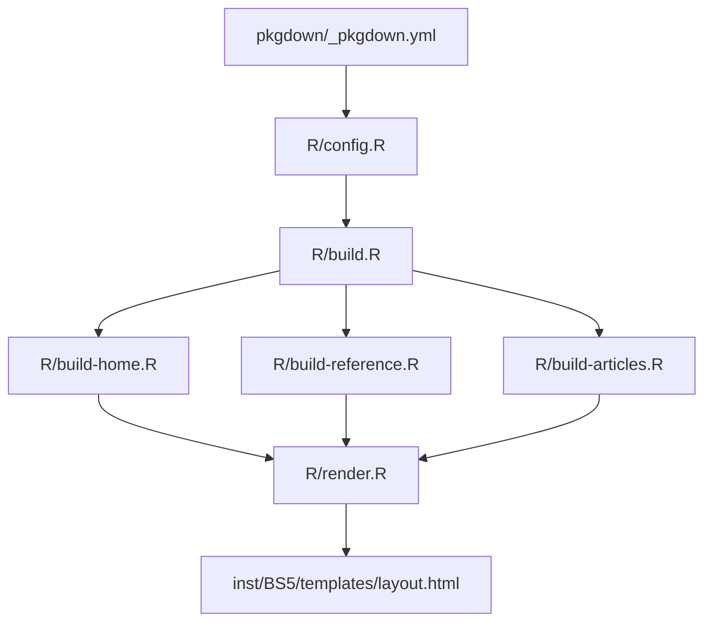

# r-lib/pkgdown

> Générateur de site web de documentation pour un paquet R, à partir de son README et de ses vignettes.

## Le problème
Documenter un paquet R sur le web oblige à assembler à la main accueil, référence des fonctions, articles et notes de version.

## Ce que ça fait vraiment
Lit `_pkgdown.yml`, transforme le README en page d'accueil, la documentation `man/` en référence de fonctions et les vignettes en articles. Les pages HTML sortent via des modèles Bootstrap 5. Utilisé par plus de 12 000 paquets selon le README.

## Comment c'est branché


## Essayer
```bash
# Installer la version CRAN
install.packages("pkgdown")
# Configurer une fois le déploiement GitHub Pages
usethis::use_pkgdown_github_pages()
# Prévisualiser le site en local
pkgdown::build_site()
```

## Coût et pièges
Gratuit, mais il faut R. Passer à Bootstrap 5 demande une option explicite dans `_pkgdown.yml` et peut casser un site très personnalisé.

## Ce que ce n'est pas
Pas un générateur de documentation généraliste : il ne sert qu'aux paquets R. Il ne rédige pas la documentation à ta place.

## Alternatives
Aucune alternative nommée dans le README.

## Pour toi
Utile seulement si tu publies un paquet R ; en Python / MLOps, il ne sert à rien, donc à ignorer.

