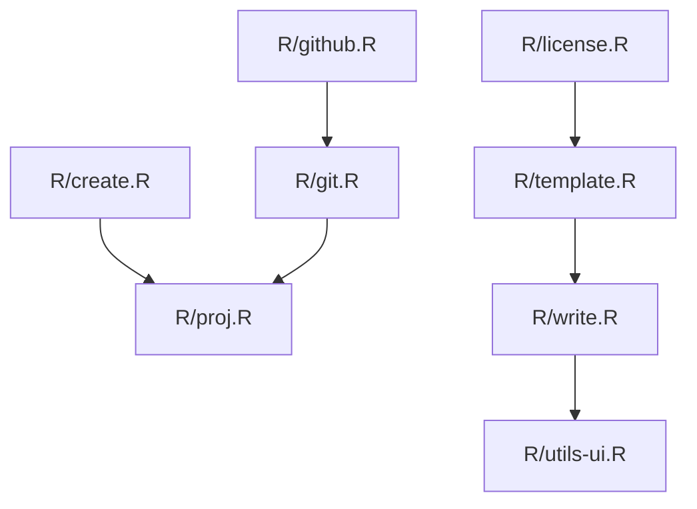

# r-lib/usethis

> R package that automates the setup of packages and analysis projects, for R developers.

## The problem
Creating an R package or a project means repeating DESCRIPTION, license, tests, git and GitHub by hand.

## What it actually does
The `use_*()` functions act on the active project: package creation, MIT license, README, NEWS, testthat tests, data, git and GitHub. It displays what it did and what remains to be done.

## How it is wired
Diagram based on the code diagram.


## Trying it
```bash
# dans R :
install.packages("usethis")
# version de développement : pak::pak("r-lib/usethis")
```

## Cost and gotchas
Free. License not identified by GitHub: to be checked. It modifies project files, so use it under git.

## What it is not
Not a Python tool nor an environment manager. It does not replace writing the package code.

## Alternatives
No alternative named in the README.

## For you
Worth watching only if you work in R: a de facto standard for structuring a package, off-topic in Python.
