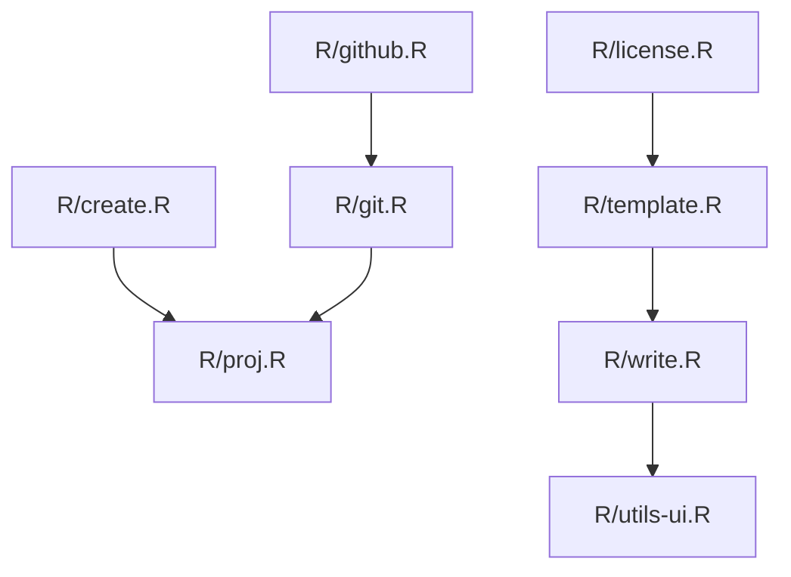

# r-lib/usethis

> Package R qui automatise la mise en place de paquets et projets d'analyse, pour développeurs R.

## Le problème
Créer un paquet R ou un projet implique de répéter à la main DESCRIPTION, licence, tests, git et GitHub.

## Ce que ça fait vraiment
Les fonctions `use_*()` agissent sur le projet actif : création de paquet, licence MIT, README, NEWS, tests testthat, données, git et GitHub. Il affiche ce qu'il a fait et ce qu'il reste à faire.

## Comment c'est branché
Schéma d'après le diagramme du code.


## Essayer
```bash
# dans R :
install.packages("usethis")
# version de développement : pak::pak("r-lib/usethis")
```

## Coût et pièges
Gratuit. Licence non identifiée par GitHub : à vérifier. Il modifie des fichiers du projet, donc à utiliser sous git.

## Ce que ce n'est pas
Pas un outil Python ni un gestionnaire d'environnements. Il ne remplace pas la rédaction du code du paquet.

## Alternatives
Aucune alternative nommée dans le README.

## Pour toi
À surveiller seulement si tu fais de l'R : standard de fait pour structurer un paquet, hors sujet en Python.

