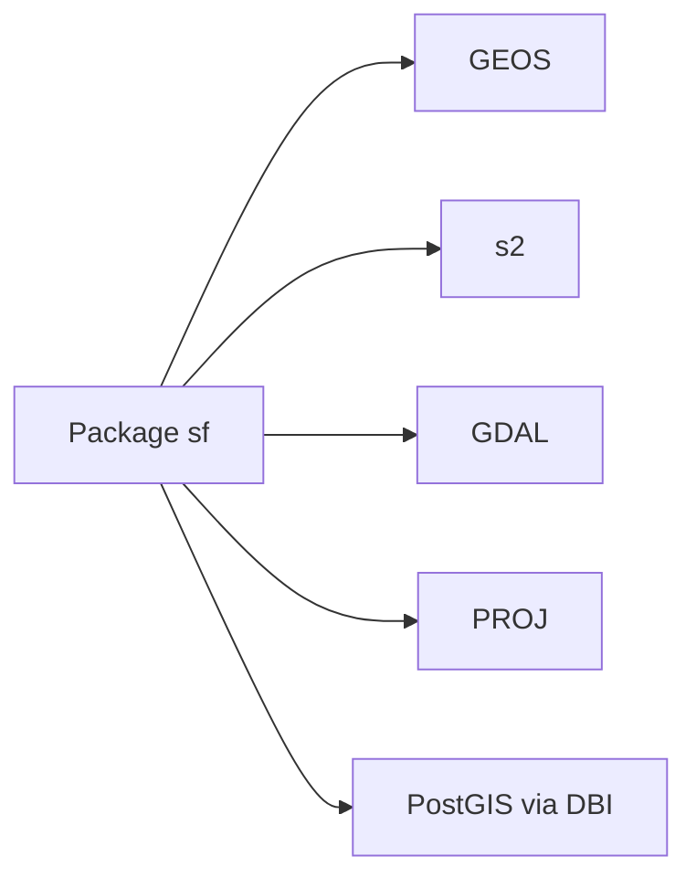

# r-spatial/sf

> R package for handling vector geospatial data in the Simple Features format.

## The problem
Geographic data in R used to be scattered across incompatible packages.

## What it actually does
Represents geometries as a list column of a `data.frame` or tibble, with the 17 Simple Features types. Interfaces to GEOS (projected geometry), s2 (ellipsoidal geometry), GDAL (formats), PROJ (coordinate systems); reads and writes PostGIS via DBI. Extended by lwgeom, stars and sfnetworks.

## How it is wired


## Trying it
```bash
install.packages("sf")
remotes::install_github("r-spatial/sf")
sudo apt -y update && apt install -y libudunits2-dev libgdal-dev libgeos-dev libproj-dev libsqlite3-dev
```
(the first two commands are R)

## Cost and gotchas
Free. Installing from source is painful (GDAL, GEOS, PROJ, udunits), especially on macOS, renv and conda; prefer the CRAN binaries.

## What it is not
Not a graphical GIS; not Python. License present but not identified by GitHub.

## Alternatives
The README cites stars (rasters) and lwgeom as extensions, not as alternatives.

## For you
Worth watching: the reference for spatial work in R; in Python, geopandas does comparable work.
