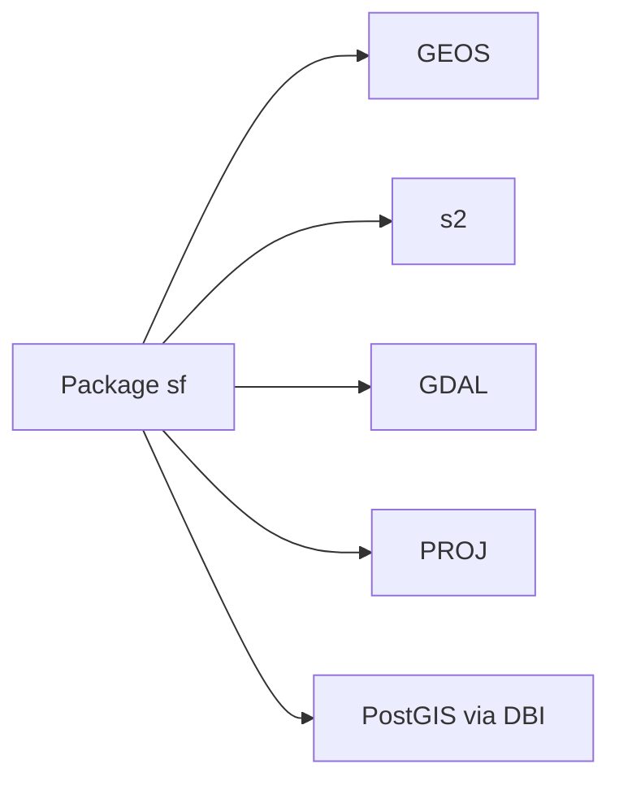

# r-spatial/sf

> Package R pour manipuler des données géospatiales vectorielles au format Simple Features.

## Le problème
Les données géographiques en R étaient éparpillées entre paquets incompatibles.

## Ce que ça fait vraiment
Représente les géométries comme colonne liste d'un `data.frame` ou tibble, avec les 17 types Simple Features. Interfaces vers GEOS (géométrie projetée), s2 (géométrie ellipsoïdale), GDAL (formats), PROJ (systèmes de coordonnées) ; lit et écrit PostGIS via DBI. Étendu par lwgeom, stars et sfnetworks.

## Comment c'est branché


## Essayer
```bash
install.packages("sf")
remotes::install_github("r-spatial/sf")
sudo apt -y update && apt install -y libudunits2-dev libgdal-dev libgeos-dev libproj-dev libsqlite3-dev
```
(les deux premières commandes sont du R)

## Coût et pièges
Gratuit. Installation depuis les sources pénible (GDAL, GEOS, PROJ, udunits), surtout macOS, renv et conda ; préférer les binaires CRAN.

## Ce que ce n'est pas
Pas un SIG graphique ; pas du Python. Licence présente mais non identifiée par GitHub.

## Alternatives
Le README cite stars (rasters) et lwgeom comme extensions, pas comme alternatives.

## Pour toi
À surveiller : référence du spatial en R ; en Python, geopandas fait un travail comparable.

