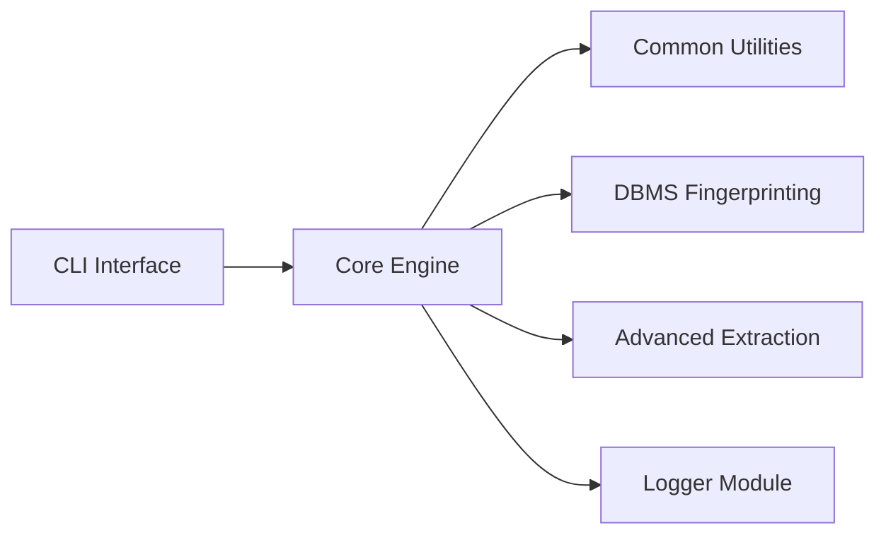

# r0oth3x49/ghauri

> A command-line SQL injection testing tool, intended for authorized security professionals.

## The problem
Checking by hand whether a web application is exposed to SQL injection is slow. The author finds SQLMap hard to configure for some simple cases.

## What it actually does
- Detects SQL injection flaws in GET and POST parameters, headers, cookies, JSON, XML/SOAP and multipart forms.
- Supports MySQL, SQL Server, Postgres, Oracle and, partially, Access.
- Resumes sessions, accepts a saved HTTP request (`-r`), a proxy and database enumeration.
- The README lists inline and UNION query support as a TODO.

## How it is wired


## Trying it
```bash
python3 -m pip install --upgrade -r requirements.txt
python3 -m pip install -e .
ghauri --help
```

## Cost and gotchas
Free. No API key. Use is legitimate only on targets you have written authorization for: the README reminds that attacking without consent is illegal.

## What it is not
Not a compliance scanner or a defensive tool. It is not presented as more complete than SQLMap; the author acknowledges missing features. The README's comparison is declarative, with no measurements.

## Alternatives
- SQLMap: richer in features, cited by the README as the reference.

## For you
Ignore: a penetration-testing tool, outside the data/AI/MLOps scope; consider it only in an authorized audit.
