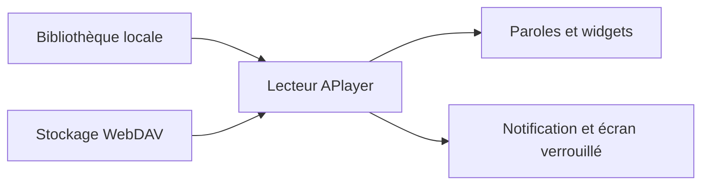

# rRemix/APlayer

> An Android music player built with Jetpack Compose, with floating lyrics and WebDAV streaming.

## The problem
Installed music players handle lyrics, theming and playback from personal storage poorly.

## What it actually does
It plays the local library (automatic or manual scan) and WebDAV. It displays embedded, local or online lyrics, word by word, floating lyrics and widgets. It offers an equalizer, speed control, sleep timer, tag editor, importable and exportable playlists, and light, dark and AMOLED themes.

## How it is wired
Simplified diagram based on the write-up, no diagram provided.



## Trying it
The README gives no command: install from Google Play or IzzyOnDroid.

```bash
# non documenté dans le README : application à installer depuis un store
```

## Cost and gotchas
Free. GPL-3.0 license. The author asks for a star and contributions.

## What it is not
Not a development tool: it is a consumer Android app. The README details neither the architecture nor the source of online lyrics.

## Alternatives
No alternative named in the README.

## For you
Ignore: an Android music player unrelated to data, AI or MLOps.
