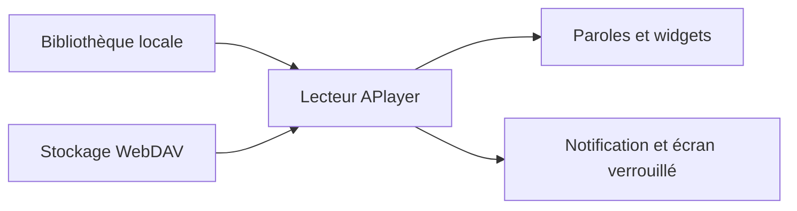

# rRemix/APlayer

> Un lecteur de musique Android en Jetpack Compose, avec paroles flottantes et diffusion WebDAV.

## Le problème
Les lecteurs de musique installés gèrent mal les paroles, le thème et la lecture depuis un stockage personnel.

## Ce que ça fait vraiment
Il lit la bibliothèque locale (scan automatique ou manuel) et du WebDAV. Il affiche des paroles intégrées, locales ou en ligne, mot à mot, des paroles flottantes et des widgets. Il propose égaliseur, vitesse, minuterie de sommeil, éditeur de tags, playlists importables et exportables, et thèmes clair, sombre et AMOLED.

## Comment c'est branché
Schéma simplifié d'après la fiche, sans diagramme fourni.



## Essayer
Le README ne donne aucune commande : installation depuis Google Play ou IzzyOnDroid.

```bash
# non documenté dans le README : application à installer depuis un store
```

## Coût et pièges
Gratuit. Licence GPL-3.0. L'auteur demande une étoile et des contributions.

## Ce que ce n'est pas
Pas un outil de développement : c'est une application Android grand public. Le README ne détaille ni l'architecture ni la source des paroles en ligne.

## Alternatives
Aucune alternative nommée dans le README.

## Pour toi
À ignorer : un lecteur de musique Android sans rapport avec la donnée, l'IA ou le MLOps.

