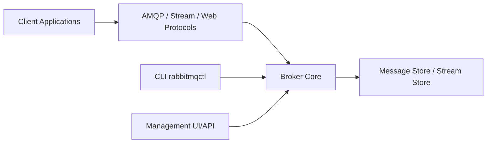

# rabbitmq/rabbitmq-server

> Multi-protocol message and stream broker, for teams that decouple services.

## The problem
Services that call each other directly are fragile; a reliable message queue is needed between them.

## What it actually does
Supports AMQP 1.0 and 0-9-1, the Stream protocol, MQTT 3.1/3.1.1/5.0, STOMP, and MQTT/STOMP over WebSocket. Replicated quorum queues and streams (persistent log). CLI tools (`rabbitmqctl`), management interface and HTTP API, OAuth/OIDC integration. The architecture provided is partial: the broker core was not sampled.

## How it is wired

## Trying it
No command in the README: it points to the installation guides, the Kubernetes Cluster Operator and the tutorials.

## Cost and gotchas
The software is free; requires a supported Erlang version. The license is stated as MPL 2.0 in the README but not identified by GitHub. AMQP 1.0 over WebSocket is part of VMware Tanzu RabbitMQ.

## What it is not
Not a database nor an analytical streaming engine.

## Alternatives
No alternative cited in the README.

## For you
Adopt it: a classic building block for feeding data pipelines through messages, under MPL 2.0 and maintained by Broadcom, with a Kubernetes Operator.
