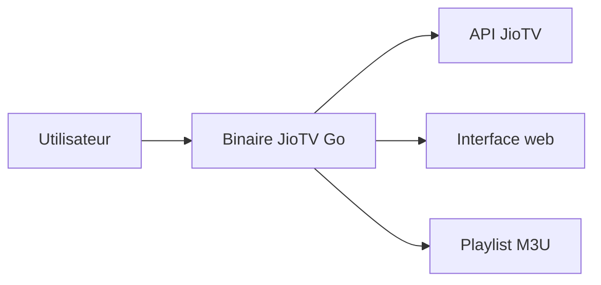

# rabilrbl/jiotv_go

> Web wrapper around the JioTV Android app's API to watch live TV or via IPTV.

## The problem
JioTV channels are only accessible through the provider's Android app.

## What it actually does
A Go binary reuses the JioTV app's API to serve a web interface, an M3U playlist for IPTV and a program guide (compressed XML or JSON). It handles authentication by Jio number with OTP, three video qualities, several simultaneous clients, a configurable port, automatic update and background startup.

## How it is wired
The README and the architecture detail no components: diagram not established.

## Trying it
No command in the provided README: download the binary from the releases, then follow the Get Started page.

## Cost and gotchas
A valid Jio number is required. The service depends on a third-party API that may change or block. The license is present but not identified by GitHub.

## What it is not
Not a content provider: it only relays access to the provider's API, which may violate its terms of use.

## Alternatives
The README names no alternative.

## For you
Ignore: diversion of a proprietary TV API, unrelated to data or AI and with a usage risk.
