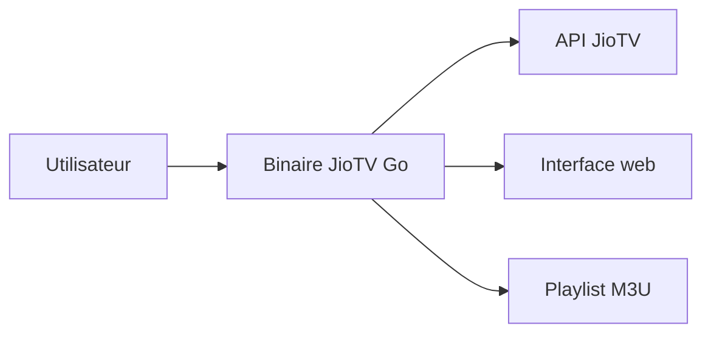

# rabilrbl/jiotv_go

> Enveloppe web autour de l'API de l'appli JioTV Android pour regarder la télé en direct ou en IPTV.

## Le problème
Les chaînes de JioTV ne sont accessibles que via l'appli Android du fournisseur.

## Ce que ça fait vraiment
Un binaire Go réutilise l'API de l'appli JioTV pour servir une interface web, une playlist M3U pour IPTV et un guide de programmes (XML compressé ou JSON). Il gère l'authentification par numéro Jio avec OTP, trois qualités vidéo, plusieurs clients simultanés, un port configurable, une mise à jour automatique et un démarrage en arrière-plan.

## Comment c'est branché
Le README et l'architecture ne détaillent pas de composants : schéma non établi.

## Essayer
Aucune commande dans le README fourni : télécharger le binaire depuis les releases puis suivre la page Get Started.

## Coût et pièges
Il faut un numéro Jio valide. Le service dépend d'une API tierce qui peut changer ou bloquer. La licence est présente mais non identifiée par GitHub.

## Ce que ce n'est pas
Pas un fournisseur de contenu : il ne fait que relayer l'accès de l'API du fournisseur, ce qui peut contrevenir à ses conditions d'usage.

## Alternatives
Le README ne nomme pas d'alternative.

## Pour toi
Ignorer : détournement d'une API propriétaire de télévision, sans lien avec la data ou l'IA et avec un risque d'usage.

