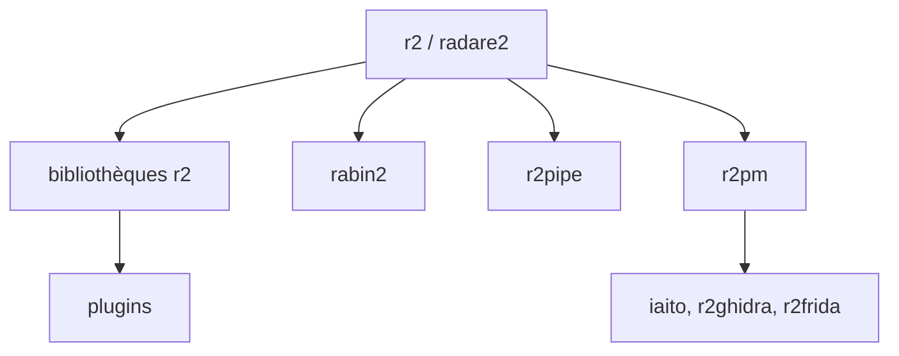

# radareorg/radare2

> Command-line reverse engineering framework: disassemble, analyze, debug, and modify binaries, for analysts.

## The problem
Analyzing an unknown binary (firmware, executable, dump) means juggling tools per architecture and per format.

## What it actually does
- Opens files, disks, or kernel memory, and disassembles, analyzes, emulates, or debugs them (locally or via remote gdb/windbg).
- Covers a very long list of architectures, formats (ELF, PE, Mach-O, WASM...) and filesystems.
- Scriptable through embedded JavaScript or r2pipe; extensible through the r2pm package manager (iaito, r2ghidra, r2frida, decai...).
- The README states LGPLv3, with each plugin possibly having its own license.

## How it is wired


## Trying it
```bash
git clone https://github.com/radareorg/radare2
radare2/sys/install.sh
r2 /bin/ls
r2pm -s <word>
```
In r2: `aaa`, `afl`, `pdf`, `q`.

## Cost and gotchas
Free; building from source is recommended. Steep learning curve, very terse commands. More than 790 open issues.

## What it is not
Not a graphical interface (that is iaito, separate). Not a turnkey tool: use assumes expertise. To be used on binaries whose content you have the right to analyze (research, forensics, interoperability), in compliance with local laws and software licenses.

## Alternatives
- r2ghidra / r4ghidra: bridge to the Ghidra decompiler.
- iaito: the official Qt interface for radare2.
- r2dec: a JS decompiler on top of r2.

## For you
Watch: useful only if you do binary analysis or reverse engineering; outside that scope, nothing for a data/AI/MLOps profile, apart from the AI plugins (decai, r2ai) to keep an eye on.
