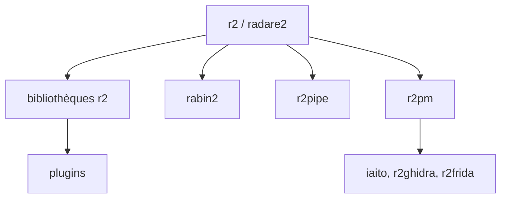

# radareorg/radare2

> Framework en ligne de commande d'ingénierie inverse : désassembler, analyser, déboguer et modifier des binaires, pour analystes.

## Le problème
Analyser un binaire inconnu (firmware, exécutable, dump) demande de jongler entre outils par architecture et par format.

## Ce que ça fait vraiment
- Ouvre des fichiers, disques ou mémoire noyau, et les désassemble, analyse, émule ou débogue (local ou gdb/windbg distant).
- Couvre une très longue liste d'architectures, de formats (ELF, PE, Mach-O, WASM...) et de systèmes de fichiers.
- Scriptable via JavaScript embarqué ou r2pipe ; extensible par le gestionnaire de paquets r2pm (iaito, r2ghidra, r2frida, decai...).
- Le README annonce la LGPLv3, chaque plugin pouvant avoir sa licence.

## Comment c'est branché


## Essayer
```bash
git clone https://github.com/radareorg/radare2
radare2/sys/install.sh
r2 /bin/ls
r2pm -s <word>
```
Dans r2 : `aaa`, `afl`, `pdf`, `q`.

## Coût et pièges
Gratuit ; compilation depuis les sources recommandée. Courbe d'apprentissage raide, commandes très concises. Plus de 790 issues ouvertes.

## Ce que ce n'est pas
Pas une interface graphique (c'est iaito, séparé). Pas un outil clé en main : l'usage suppose de l'expertise. À utiliser sur des binaires dont on a le droit d'analyser le contenu (recherche, forensique, interopérabilité), dans le respect des lois locales et des licences logicielles.

## Alternatives
- r2ghidra / r4ghidra : pont avec le décompilateur Ghidra.
- iaito : interface Qt officielle de radare2.
- r2dec : décompilateur en JS sur r2.

## Pour toi
Surveiller : utile seulement si tu fais de l'analyse binaire ou du reverse ; hors de ce périmètre, rien pour un profil data/IA/MLOps, hormis les plugins IA (decai, r2ai) à observer.

