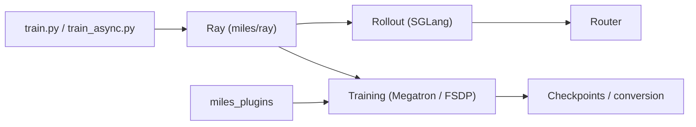

# radixark/miles

> Reinforcement learning framework for post-training very large models, built on SGLang and Megatron-LM.

## The problem
Running RL (GRPO, PPO) on very large models requires running generation and training in parallel, without the two diverging.

## What it actually does
Separates rollout (SGLang behind a router) from training (Megatron-LM, or FSDP2 as a secondary option), orchestrated by Ray, in asynchronous mode. Offers: tokens-in-tokens-out (TITO), MoE routing replay (R3), hot recovery if an engine goes down, MXFP8/NVFP4/FP8/INT4 training, multiple LoRA, agent environments (Harbor, HUD, Verifiers, etc.) and diffusion. Forked from slime. Supports NVIDIA and AMD GPUs.

## How it is wired

## Trying it
The README gives no command: it points to "Install Miles" and "Quick Start" (external documentation).

## Cost and gotchas
Assumes clusters of recent GPUs (H100/B200/MI300...). 1,015 open issues. The announced speed results (weights in seconds on a one-trillion-parameter model) cannot be verified here.

## What it is not
Not a lightweight fine-tuning tool: designed for large-scale post-training, with substantial infrastructure.

## Alternatives
`slime`, from which it was forked (cited in the README).

## For you
Ignore: the targeted scale (multi-GPU clusters) exceeds a typical data/MLOps profile; bring it back up for an RL-on-LLM project.
