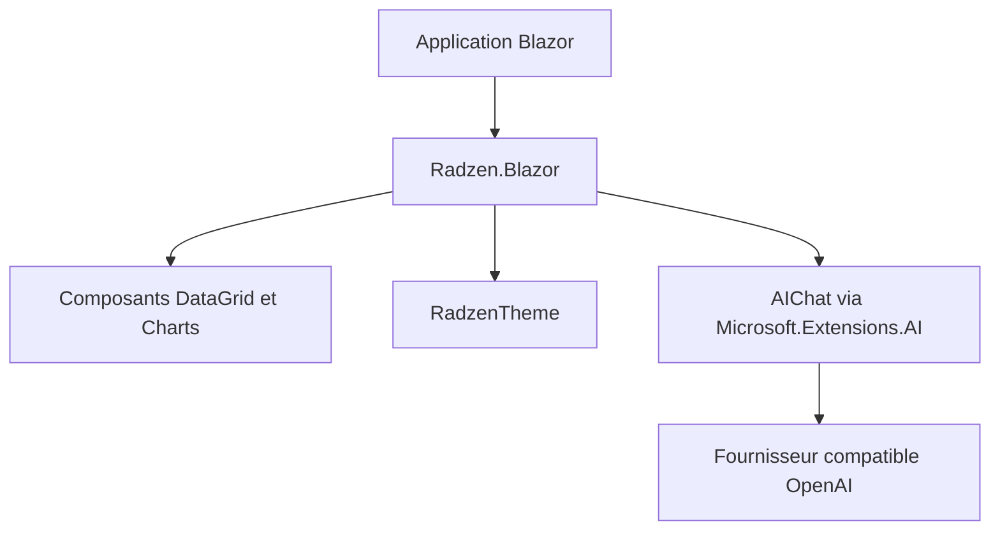

# radzenhq/radzen-blazor

> Blazor UI component library, for .NET developers building web applications.

## The problem
Building grids, schedulers and charts in Blazor by hand takes a lot of code.

## What it actually does
More than 155 native C# components: DataGrid, Scheduler, Gantt, spreadsheet with formulas, more than thirty chart types drawn in SVG, plus an AI kit (AIChat, AIPrompt, SmartPasteButton) based on Microsoft.Extensions.AI and compatible with any OpenAI-compatible provider. Supports .NET 8, 9 and 10.

## How it is wired
Simplified diagram based on the write-up, no diagram provided.



## Trying it
```bash
dotnet add package Radzen.Blazor
```
```razor
<RadzenTheme Theme="material" />
<RadzenButton Text="Hello World" Click="@OnClick" />
```

## Cost and gotchas
Free library (MIT). The paid Pro offer adds premium themes, support, Radzen Blazor Studio and the MCP server. The AI components require a model provider at your own expense.

## What it is not
It is not a data science tool: it is a .NET UI kit. Radzen's MCP server is reserved for the Pro subscription.

## Alternatives
No alternative named in the README.

## For you
Ignore unless you build dashboards in .NET: a solid library but outside the usual Python stack of a data / AI profile.
