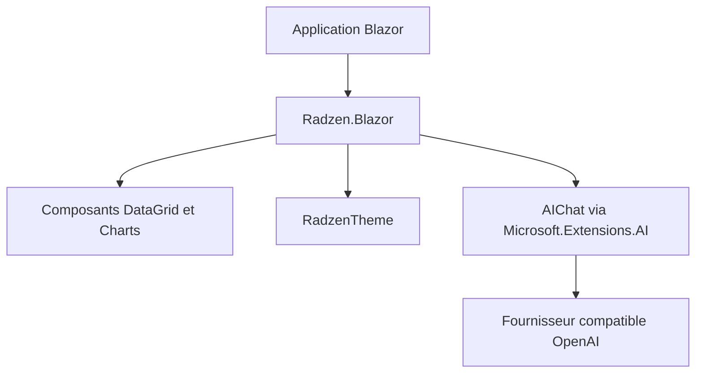

# radzenhq/radzen-blazor

> Bibliothèque de composants d'interface Blazor, pour les développeurs .NET qui construisent des applications web.

## Le problème
Construire grilles, planificateurs et graphiques en Blazor à la main demande beaucoup de code.

## Ce que ça fait vraiment
Plus de 155 composants natifs C# : DataGrid, Scheduler, Gantt, tableur avec formules, plus de trente types de graphiques tracés en SVG, ainsi qu'un kit IA (AIChat, AIPrompt, SmartPasteButton) fondé sur Microsoft.Extensions.AI et compatible avec tout fournisseur compatible OpenAI. Supporte .NET 8, 9 et 10.

## Comment c'est branché
Schéma simplifié d'après la fiche, sans diagramme fourni.



## Essayer
```bash
dotnet add package Radzen.Blazor
```
```razor
<RadzenTheme Theme="material" />
<RadzenButton Text="Hello World" Click="@OnClick" />
```

## Coût et pièges
Bibliothèque gratuite (MIT). L'offre Pro payante ajoute thèmes premium, support, Radzen Blazor Studio et le serveur MCP. Les composants IA nécessitent un fournisseur de modèle à ta charge.

## Ce que ce n'est pas
Ce n'est pas un outil de data science : c'est un kit d'interface .NET. Le serveur MCP de Radzen est réservé à l'abonnement Pro.

## Alternatives
Aucune alternative nommée dans le README.

## Pour toi
Ignorer sauf si tu construis des tableaux de bord en .NET : bibliothèque solide mais hors de la pile Python habituelle d'un profil data / IA.

