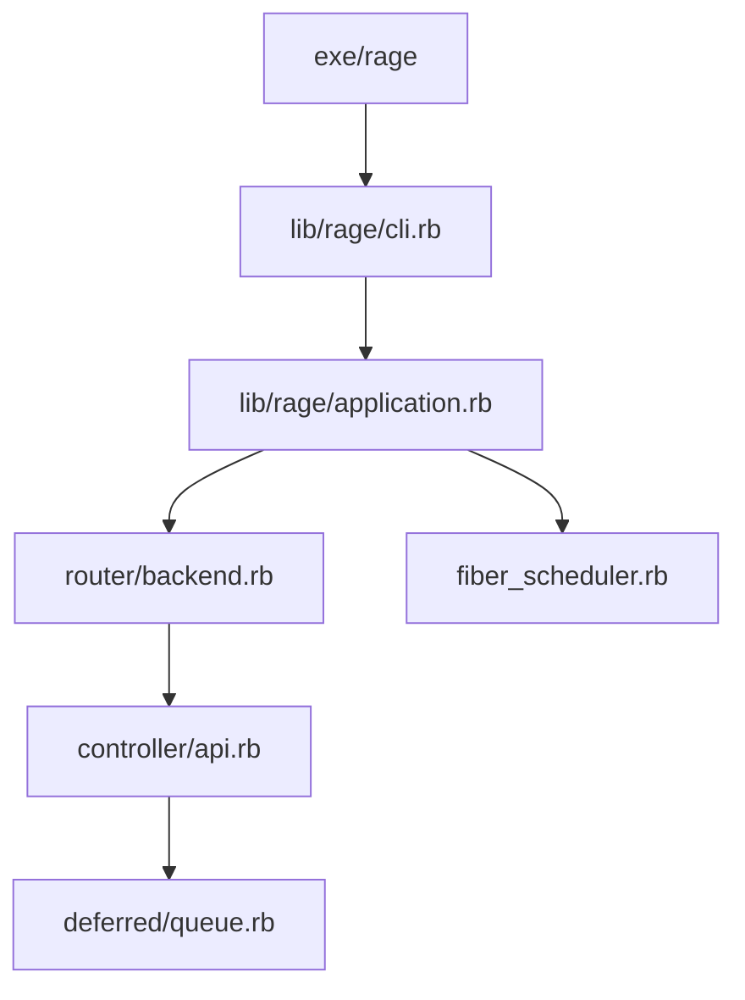

# rage-rb/rage

> Rails-compatible Ruby API framework, with fiber-based concurrency and background tasks in the same process.

## The problem
A modern Ruby backend demands Redis, Sidekiq and several processes, hence more infrastructure.

## What it actually does
Each request runs in a fiber that pauses during I/O. Action Cable-compatible WebSockets, SSE streams, deferred tasks persisted on disk, OpenAPI generated from controller comments, built-in telemetry. Usable on its own or added to a Rails application.

## How it is wired


## Trying it
```bash
gem install rage-rb
rage new my_app
cd my_app
bundle install
rage s
```

## Cost and gotchas
Free. Ruby only. The SSE stream is designed for streaming LLM responses; in-process tasks are lost if the process dies, unless persisted on disk.

## What it is not
Not full Rails: API-oriented. No distributed external queue.

## Alternatives
Rails with Sidekiq and Redis, which Rage aims to avoid.

## For you
Ignore: a Ruby framework, outside your profile; you will serve your models with FastAPI or equivalent.
