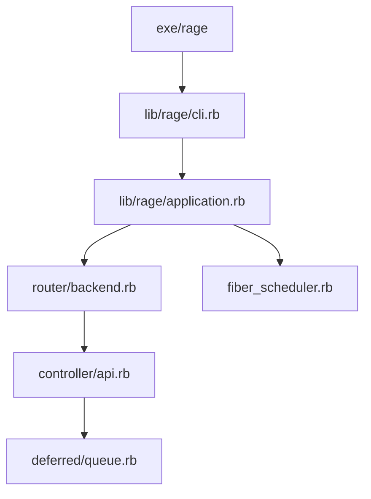

# rage-rb/rage

> Framework Ruby d'API compatible Rails, avec concurrence par fibres et tâches de fond dans le même processus.

## Le problème
Un backend Ruby moderne réclame Redis, Sidekiq et plusieurs processus, donc plus d'infrastructure.

## Ce que ça fait vraiment
Chaque requête tourne dans une fibre qui se met en pause pendant les entrées-sorties. WebSockets compatibles Action Cable, flux SSE, tâches différées persistées sur disque, OpenAPI générée depuis les commentaires des contrôleurs, télémétrie intégrée. Utilisable seul ou ajouté à une application Rails.

## Comment c'est branché


## Essayer
```bash
gem install rage-rb
rage new my_app
cd my_app
bundle install
rage s
```

## Coût et pièges
Gratuit. Réservé à Ruby. Le flux SSE est pensé pour le streaming de réponses de LLM ; les tâches en processus se perdent si le processus meurt, sauf persistance sur disque.

## Ce que ce n'est pas
Pas Rails complet : orienté API. Pas de file externe distribuée.

## Alternatives
Rails avec Sidekiq et Redis, que Rage veut éviter.

## Pour toi
Ignorer : framework Ruby, hors de ton profil ; tu serviras tes modèles avec FastAPI ou équivalent.

