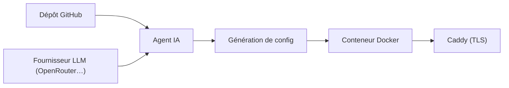

# raghavyuva/nixopus

> Self-hosted deployment platform with an AI agent that deploys, monitors and fixes applications.

## The problem
When a deployment fails, you have to reread the logs, ask an AI for a fix, push again and redeploy.

## What it actually does
A VPS-based platform that connects to your GitHub repository, generates the build configuration, and deploys in a container with automatic TLS (Caddy, Let's Encrypt), domains and rollbacks. An agent by chat, from the dashboard or from VS Code and Cursor. Built-in terminal and containers, multiple servers. The automatic fix loop is marked "in development".

## How it is wired


## Trying it
```bash
curl -fsSL install.nixopus.com | sudo bash
```

## Cost and gotchas
LLM provider key at your expense; dedicated VPS recommended (1 GB minimum, root access), Docker installed automatically. The first person to sign up becomes admin.

## What it is not
The license is not recognized by GitHub; the README states AGPL-3.0 with a possible commercial license. The "self-healing" is not shipped yet.

## Alternatives
No alternative named in the README.

## For you
Worth watching: interesting for small ML demo hosting, but the autonomous loop does not exist yet and the license remains to be verified.
