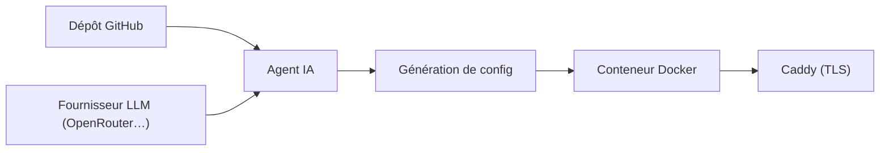

# raghavyuva/nixopus

> Plateforme de déploiement auto-hébergée avec un agent IA qui déploie, surveille et corrige les applications.

## Le problème
Quand un déploiement échoue, il faut relire les logs, demander un correctif à une IA, repousser et redéployer.

## Ce que ça fait vraiment
Une plateforme sur VPS qui relie ton dépôt GitHub, génère la configuration de build, déploie en conteneur avec TLS automatique (Caddy, Let's Encrypt), domaines et retours arrière. Un agent par chat, depuis le tableau de bord ou VS Code et Cursor. Terminal et conteneurs intégrés, plusieurs serveurs. La boucle de correction automatique est marquée « en développement ».

## Comment c'est branché


## Essayer
```bash
curl -fsSL install.nixopus.com | sudo bash
```

## Coût et pièges
Clé de fournisseur LLM à ta charge ; VPS dédié recommandé (1 Go minimum, accès root), Docker installé automatiquement. Le premier inscrit devient admin.

## Ce que ce n'est pas
La licence n'est pas reconnue par GitHub ; le README annonce AGPL-3.0 avec licence commerciale possible. Le « self-healing » n'est pas encore livré.

## Alternatives
Aucune alternative nommée dans le README.

## Pour toi
À surveiller : intéressant pour un petit hébergement de démos ML, mais la boucle autonome n'existe pas encore et la licence reste à vérifier.

