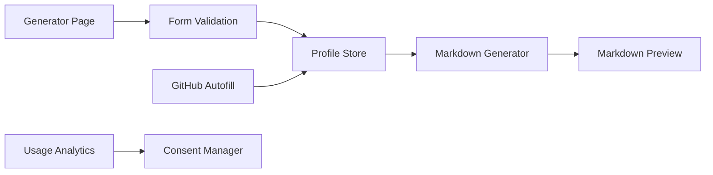

# rahuldkjain/github-profile-readme-generator

> Web application that generates a GitHub profile README from a form.

## The problem
Writing a profile README by hand with badges, statistics and icons.

## What it actually does
You fill in a form (name, links, social networks, skills) and the tool produces Markdown, with preview, copy and download. Options: visitor counter, GitHub stats, contribution streaks, dynamic blogs (GitHub Action), Wakatime. A client-side Next.js 15 application, with local saving and automatic filling via the GitHub API.

## How it is wired


## Trying it
```bash
git clone https://github.com/rahuldkjain/github-profile-readme-generator.git
cd github-profile-readme-generator
npm install
npm run dev
```

## Cost and gotchas
Free. The README announces Google Analytics 4 with a consent banner. The Wotfard font is used "under fair use": the README asks you to check the license for commercial use.

## What it is not
It is not a development tool: it generates decorative Markdown. The badges depend on external third-party services.

## Alternatives
No alternative named in the README.

## For you
Ignore: it serves to decorate a profile page, with no value for data/AI work; telemetry and a vague font license on top.
