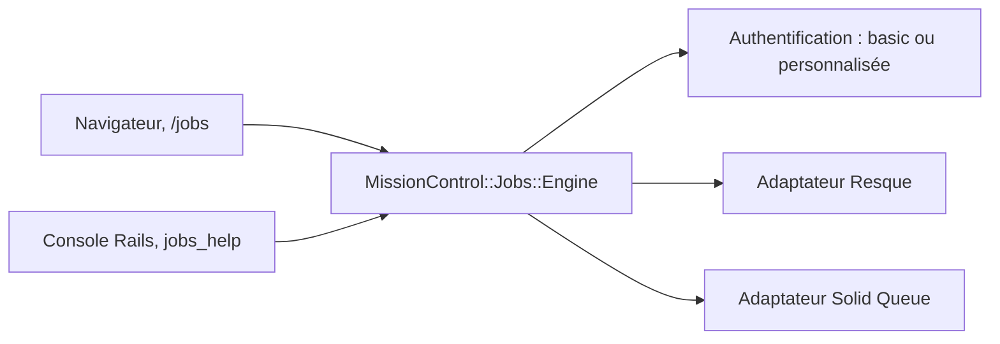

# rails/mission_control-jobs

> Rails web interface to inspect, retry and delete Active Job jobs (Resque, Solid Queue).

## The problem
Without a dedicated tool, understanding why background jobs fail or pile up means digging through Redis or the database by hand.

## What it actually does
A Rails engine to mount in `routes.rb` that lists queues and jobs by status, filtered by queue or class. It lets you retry or delete failed jobs, pause a queue and see workers. A console API allows bulk operations. It handles several applications and several adapters.

## How it is wired


## Trying it
```bash
bundle install
bin/rails mission_control:jobs:authentication:configure
```
Add `gem "mission_control-jobs"` to the Gemfile, then `mount MissionControl::Jobs::Engine, at: "/jobs"`.

## Cost and gotchas
Free. HTTP basic authentication is closed by default: without credentials, the interface is inaccessible. Solid Queue requires version 1.0.1 or higher.

## What it is not
Not a general monitoring or scheduling tool. Features depend on the adapter, and destructive bulk operations are mostly done in the console.

## Alternatives
No alternative named in the README.

## For you
Ignore unless you run a Rails application; it concerns neither Airflow nor data or AI pipelines.
